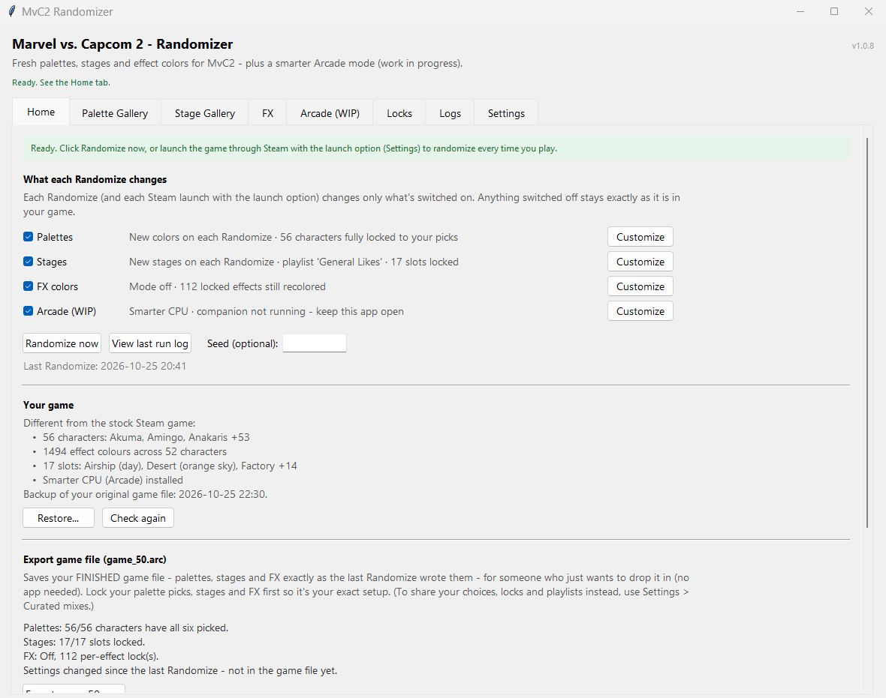
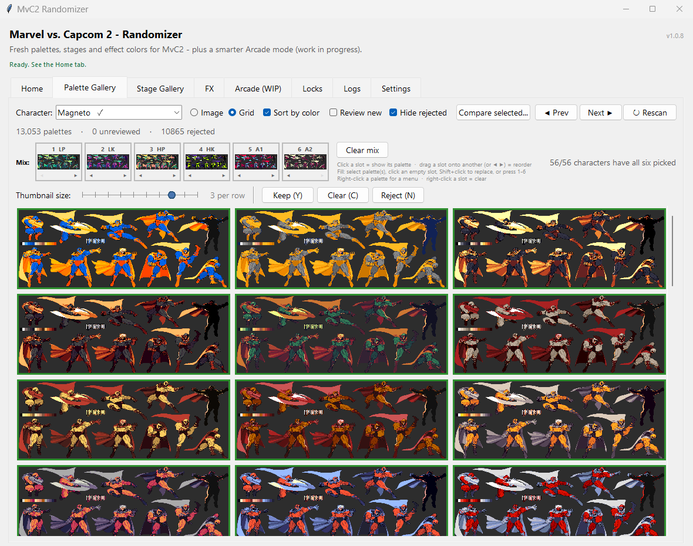
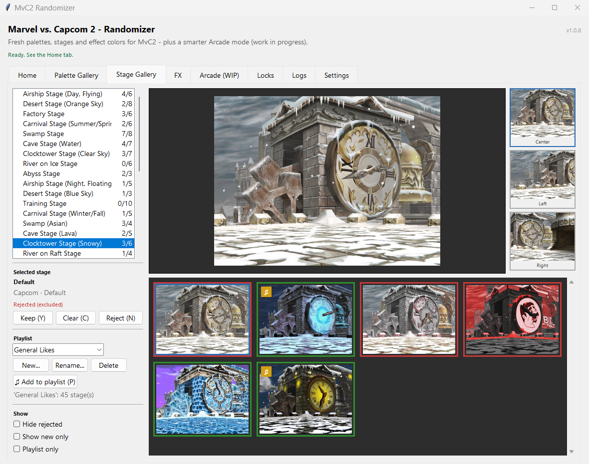
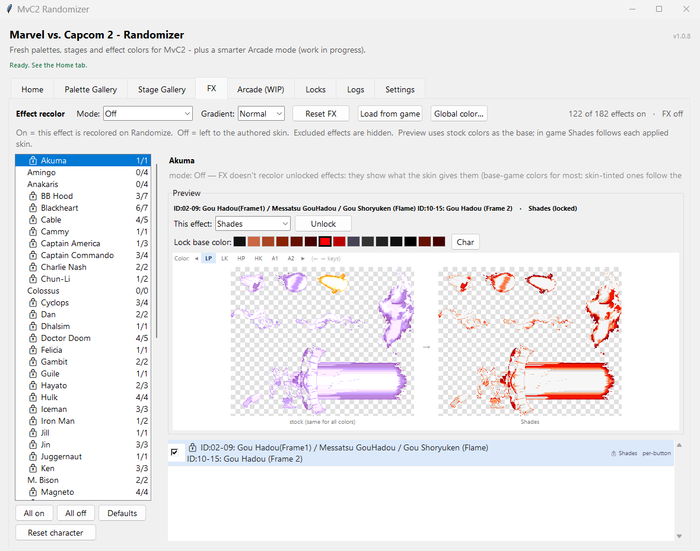
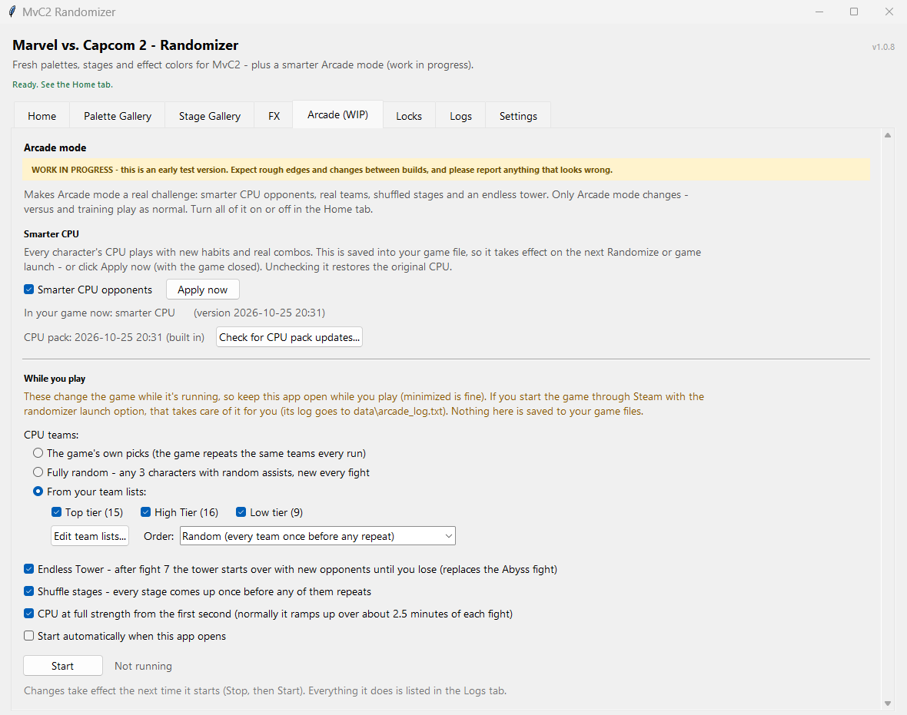
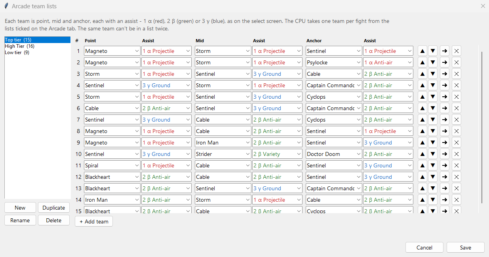
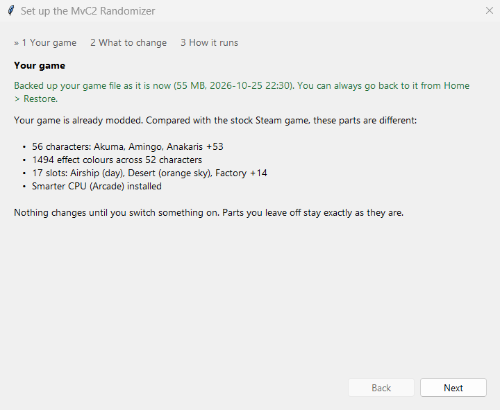
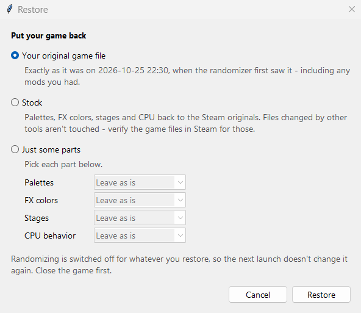

# MvC2 Randomizer

An archive of community-made art for **Marvel vs. Capcom 2** - **13,000+ character
palettes and 200+ stages** - and a Windows app that brings it into the Steam
*MARVEL vs. CAPCOM Fighting Collection*.

The stages are community retextures of MvC2's own stages, ports of stages from other
games, and entirely new originals. Pick the ones you like and the app mixes them into
your game: new looks every time you play, or exactly the setup you choose.

> **[Download MvC2Randomizer.exe from the latest release](https://github.com/karttoon/mvc2-randomizer/releases/latest)**
>
> It's a single Windows exe with nothing to install. You need the Steam *MARVEL vs. CAPCOM
> Fighting Collection: Arcade Classics*. See [Getting started](#getting-started).

## The archive

### Palettes

Over 13,000 palettes across every character and all six button colors, from the
[MvC2 Skins Gallery](https://github.com/karttoon/mvc2-skins). Review them in the
Palette Gallery and keep or reject each one. There's no limit on how many you keep -
every kept palette goes into the pool, so the more you like, the more variety you get.

### Stages

202 stages for MvC2's 17 stage slots: 83 retextures of the original stages, 103 ports
from other games and 16 brand-new originals. Keep the ones you like (green), reject the
rest (red), and group favorites into playlists. Ports and originals can go into any
stage slot, not just Training.

## FX colors

Fireballs, beams, sparks and other effects get their own coloring - ten color themes
(Shades, Opposite, Rainbow, Rainbow Reverse, Grayscale, Invert, Chaos, Thermal, Night
Vision and Neon) on top of the stock colors. Set a theme for the whole cast, then lock
individual effects to their own theme and base color per button, so every character
can look different. A few effects follow the character's palette; most take on the
theme you pick.

## Arcade mode (work in progress)

Arcade mode, turned up to 11. The CPU is far more aggressive in how it plays, uses
dozens of real combos on every character, and fights at full strength from the first
second. It also deals and takes full damage, like a human player (stock MvC2 scales
every CPU hit to 75%). These fights are a real challenge now - and a lot of fun.

- **CPU teams** - the game's own picks, **fully random** teams (any three characters with
  random assists, new every fight), or teams from your own lists
- **Endless Tower** - after fight 7 the tower starts over with new opponents until you lose
- **Shuffled stages** - every stage comes up once before any of them repeats
- **CPU updates** - the CPU keeps improving between app releases. **Check for CPU pack
  updates** (Arcade tab, or Settings > Content) shows whether a newer CPU is out and
  downloads it if you say so - the app never goes online unless you click.

Build your own CPU team lists - characters and their α / β / γ assists, colored as on
the select screen:

The live Arcade features run alongside the game, so keep the app open while you play
(minimized is fine) or start the game through Steam with the launch option.

## Getting started

1. Download **`MvC2Randomizer.exe`** from the
   [latest release](https://github.com/karttoon/mvc2-randomizer/releases/latest) and put it in a
   folder of its own - it keeps its settings in a `data` folder next to it.
2. Run it. First-time setup finds your game, backs up your game file, and shows what's
   already different from the stock game.

   

3. Choose what to change - palettes, stages, FX colors, Arcade. Everything starts off.
4. For palettes or stages, download the archive: **Settings > Content > Download / Update
   gallery content** (about 750 MB; an update downloads it again in full).
5. Click **Randomize now** on the Home tab - or use **Settings > Enable Auto-Randomize in
   Steam** to add a launch option, and every Play from Steam applies your settings
   before the game starts.

## Your game stays safe

Before changing anything, the app saves a copy of your game file exactly as it was.
**Home > Restore** puts back that original file, the stock game, or just some parts
(palettes, FX colors, stages, CPU). Anything you switch off is left exactly as it is,
and edits made with other tools (e.g. PalMod) are detected and protected.

Files changed by *other* tools can only be reset by Steam: right-click the game >
Properties > Installed Files > **Verify integrity of game files**.

## Locks, mixes and sharing

- **Locks** - pin a palette to a character's button, or a stage to a slot, so it never
  changes.
- **Your mix** - pick the six palettes you want for a character (one per button) right in
  the Palette Gallery.
- **Export game file** (Home) - save your finished game file for someone who just wants
  to drop it in, no app needed.
- **Curated mixes** (Settings) - share your keeps, rejects, locks, playlists and FX setup,
  or start from someone else's.

## Something wrong?

**Settings > Save support info** zips your settings and logs (never your game file) to
send with a bug report.

## Credits

Palettes and stages are made by the MvC2 community - see the
[MvC2 Skins Gallery](https://github.com/karttoon/mvc2-skins) for the artists. Palette
data and character offsets come from [PalMod](https://github.com/Preppy/PalMod)'s MvC2
definitions.

## License

MIT
