# MvC2 Randomizer

An archive of community-made art for **Marvel vs. Capcom 2** - **13,000+ character
palettes and 200+ stages** - and a Windows app that brings it into the Steam
*MARVEL vs. CAPCOM Fighting Collection*.

The stages are community retextures of MvC2's own stages, ports of stages from other
games, and entirely new originals. Pick the ones you like and the app mixes them into
your game: new looks every time you play, or exactly the setup you choose.

> **[Download MvC2Randomizer.exe from the latest release](https://github.com/karttoon/mvc2-randomizer/releases/latest)**
>
> It's a single Windows exe with nothing to install. You need the Steam *MARVEL vs. CAPCOM
> Fighting Collection: Arcade Classics*. See [Getting started](#getting-started).

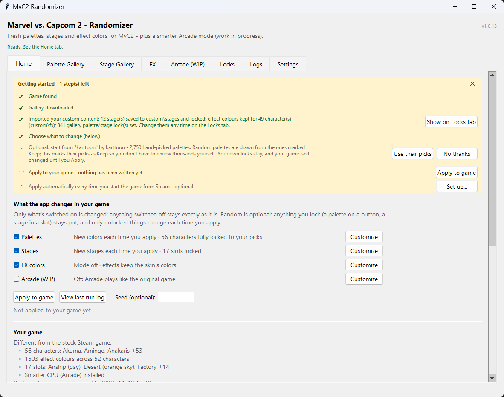

## The archive

### Palettes

Over 13,000 palettes across every character and all six button colors, from the
[MvC2 Skins Gallery](https://github.com/karttoon/mvc2-skins). Review them in the
Palette Gallery and keep or reject each one. There's no limit on how many you keep -
every kept palette goes into the pool, so the more you like, the more variety you get.

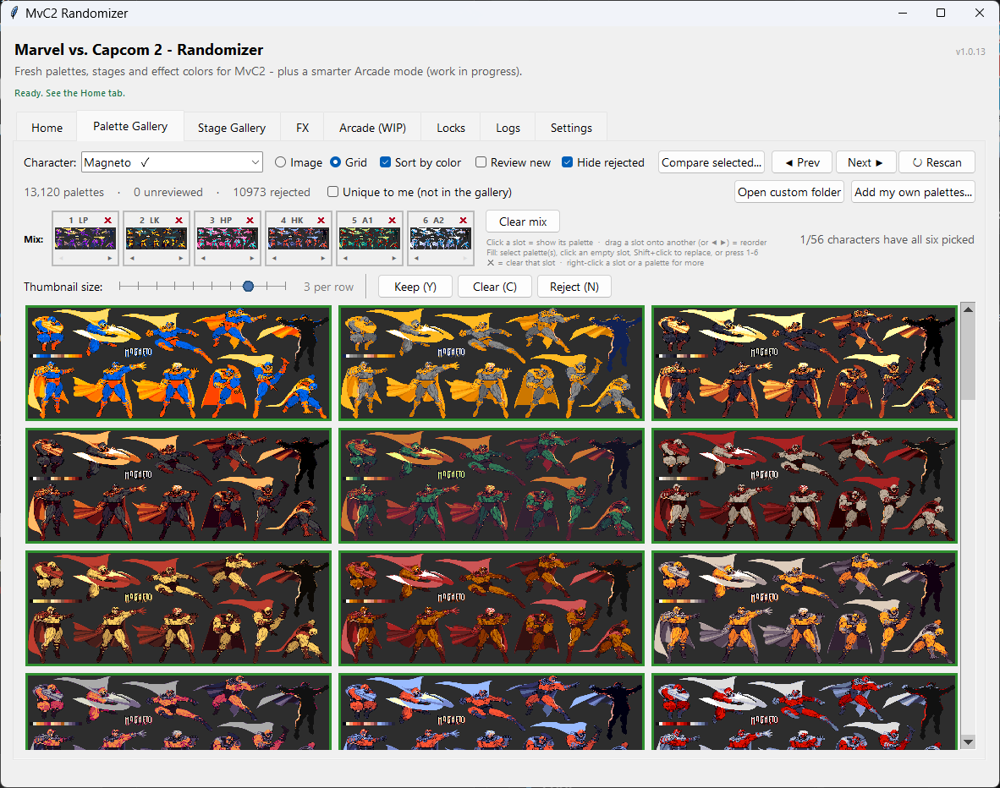

### Stages

202 stages for MvC2's 17 stage slots: 83 retextures of the original stages, 103 ports
from other games and 16 brand-new originals. Keep the ones you like (green), reject the
rest (red), and group favorites into playlists. Ports and originals can go into any
stage slot, not just Training.

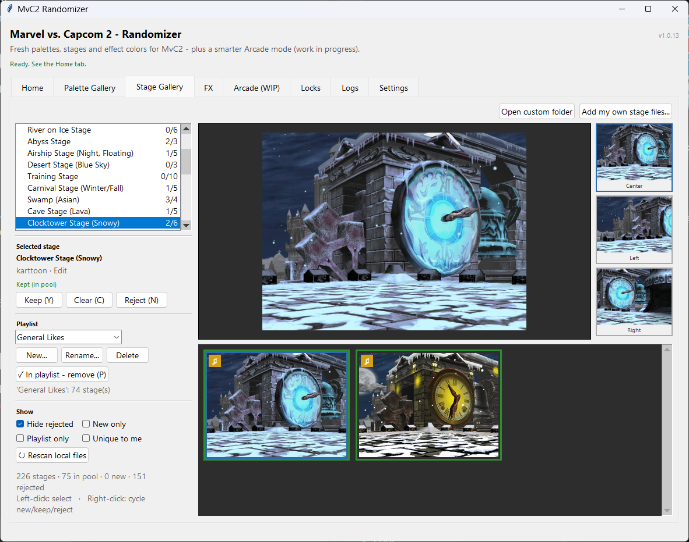

## FX colors

Fireballs, beams, sparks and other effects get their own coloring - ten color themes
(Shades, Opposite, Rainbow, Rainbow Reverse, Grayscale, Invert, Chaos, Thermal, Night
Vision and Neon) on top of the stock colors. Set a theme for the whole cast, then lock
individual effects to their own theme and base color per button, so every character
can look different. A few effects follow the character's palette; most take on the
theme you pick.

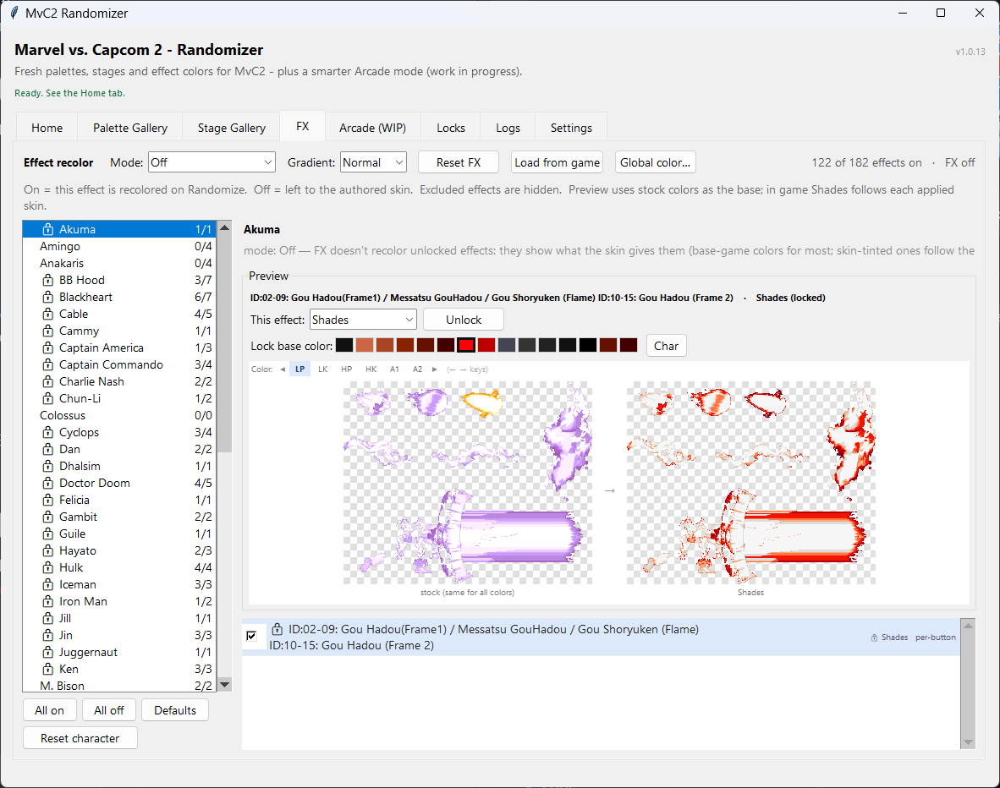

## Arcade mode (work in progress)

Arcade mode, turned up to 11. The CPU is far more aggressive in how it plays, uses
dozens of real combos on every character, and fights at full strength from the first
second. It also deals and takes full damage, like a human player (stock MvC2 scales
every CPU hit to 75%). These fights are a real challenge now - and a lot of fun.

- **CPU teams** - the game's own picks, **fully random** teams (any three characters with
  random assists, new every fight), or teams from your own lists
- **Endless Tower** - after fight 7 the tower starts over with new opponents until you lose
- **Shuffled stages** - every stage comes up once before any of them repeats
- **CPU updates** - the CPU keeps improving between app releases. **Check for CPU pack
  updates** (Arcade tab, or Settings > Content) shows whether a newer CPU is out and
  downloads it if you say so - the app never goes online unless you click.
- **Update checks (optional, off by default)** - **Settings > Updates** can check for a new
  app version, CPU pack and gallery content each time the app starts (each one on or off).
  Anything new shows as a gold dot on its tab and a line at the bottom of the window - no
  pop-ups. The app can update itself in one click (it checks the download's fingerprint
  first), and CPU packs can install automatically.

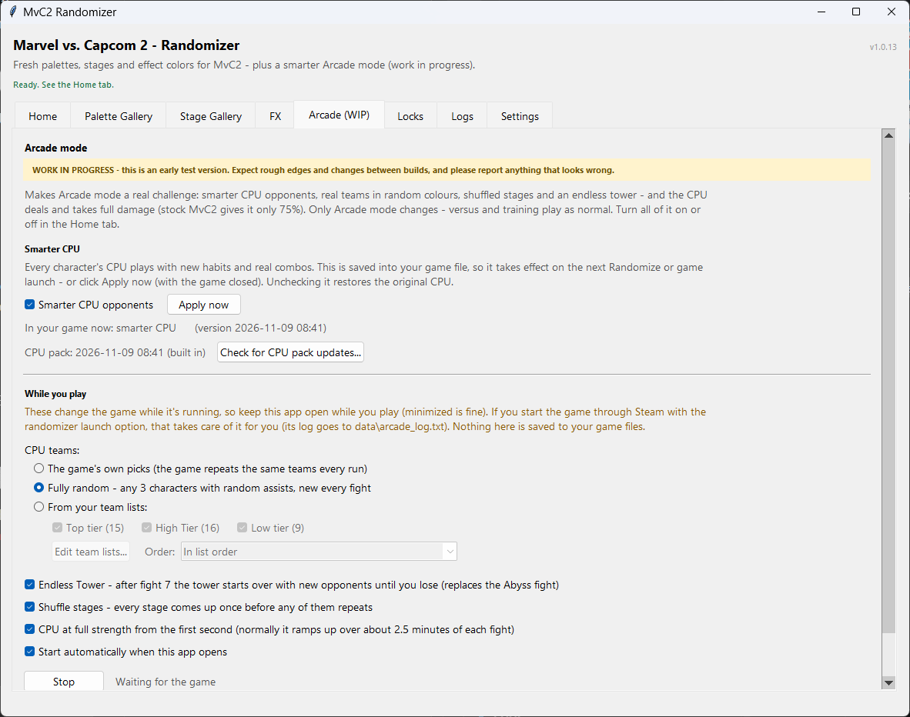

Build your own CPU team lists - characters and their α / β / γ assists, colored as on
the select screen:

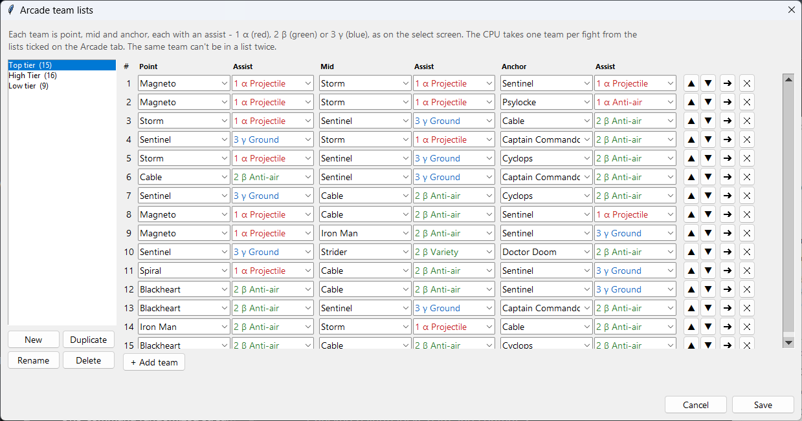

The live Arcade features run alongside the game, so keep the app open while you play
(minimized is fine) or start the game through Steam with the launch option.

## Getting started

1. Download **`MvC2Randomizer.exe`** from the
   [latest release](https://github.com/karttoon/mvc2-randomizer/releases/latest) and put it in a
   folder of its own - it keeps its settings in a `data` folder next to it.
2. Run it. First-time setup finds your game, backs up your game file, and shows what's
   already different from the stock game. If your game is already modded (PalMod colours,
   stage mods, an earlier randomizer), leave **Import my custom colours and stages** ticked -
   see [Already modded?](#already-modded-import-your-custom-content).

   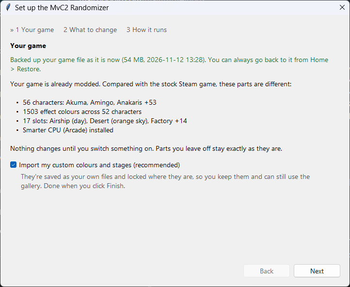

3. Pick a starting point, or switch parts on and off yourself:
   - **Shuffle everything** - new colours and stages every time; lock anything you want to keep.
   - **Just add stages - keep my colours** - your colours stay exactly as they are.
   - **I'll pick everything myself** - everything starts off and nothing in your game
     changes. Pick palettes and stages in the galleries, then switch Palettes / Stages on.

   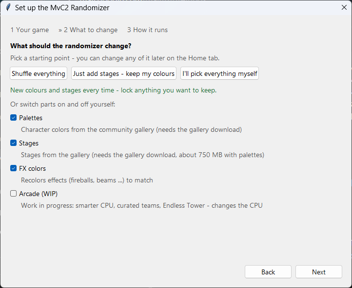

4. The **Getting started** checklist at the top of the Home tab shows what's left, with a
   button for each step:
   - **Download** the gallery - the community palettes and stages, about 750 MB, not
     included in the app. Progress shows at the bottom of the window, and you can keep
     using the app while it runs.
   - Optionally start from a **curated list** of hand-picked palettes, so you don't have to
     review thousands yourself. It only marks palettes as Keep; your own locks stay.
   - **Apply to game** writes your settings into the game. Nothing changes until you do.
   - Optionally **Set up...** the Steam launch option, so every Play from Steam applies your
     settings before the game starts.

   (That's the Home tab at the top of this page.)

Random is optional: anything you lock (a palette on a button, a stage in a slot) stays put,
and only unlocked things change. Random picks come from what you've **Kept** in the
galleries - plus everything you haven't reviewed yet when **Settings > Randomize pool**
includes it (the Shuffle and Just-add-stages starting points turn that on).

## Your game stays safe

Before changing anything, the app saves a copy of your game file exactly as it was.
**Home > Restore** puts back that original file, the stock game, or just some parts
(palettes, FX colors, stages, CPU). Anything you switch off is left exactly as it is,
and edits made with other tools (e.g. PalMod) are detected and left alone until you import them.

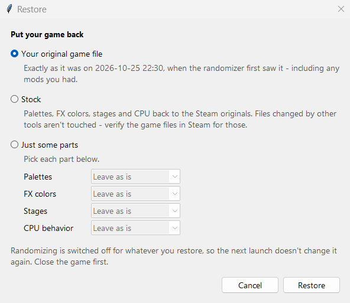

Files changed by *other* tools can only be reset by Steam: right-click the game >
Properties > Installed Files > **Verify integrity of game files**.

## Your own palettes and stages

### Already modded? Import your custom content

Tick the box in first-time setup, or use **Home > Import custom content...** any time. The
app reads your game (or your original game file, or someone else's `game_50.arc`) and saves
what it finds as files it manages, locked where they are:

- **Palettes** go to `custom\skins\<Character>\` as gallery-format sheets, locked to the
  button they were on.
- **Hand-edited effect colours** go to `custom\fx\` and are put back on every apply.
- **Stages** go to `custom\stages\`, locked to their slot.

Your game looks exactly the same after the next apply - and from then on you can mix, swap
and share it all like gallery content.

**Matching to the gallery.** Anything you import that's really a gallery item - even with FX
colours on top - becomes that gallery item, with its name and preview, still locked where it
was. This runs by itself after every gallery download; **Settings > Match my own files to the
gallery** runs it again after you add files of your own.

**Imported stages stay in their slot.** A stage taken from a game file can be a version made
for that one slot (a ported stage merged into Abyss, say), so it's only offered in the slot it
came from. Stages without a preview get a card that says what they are:

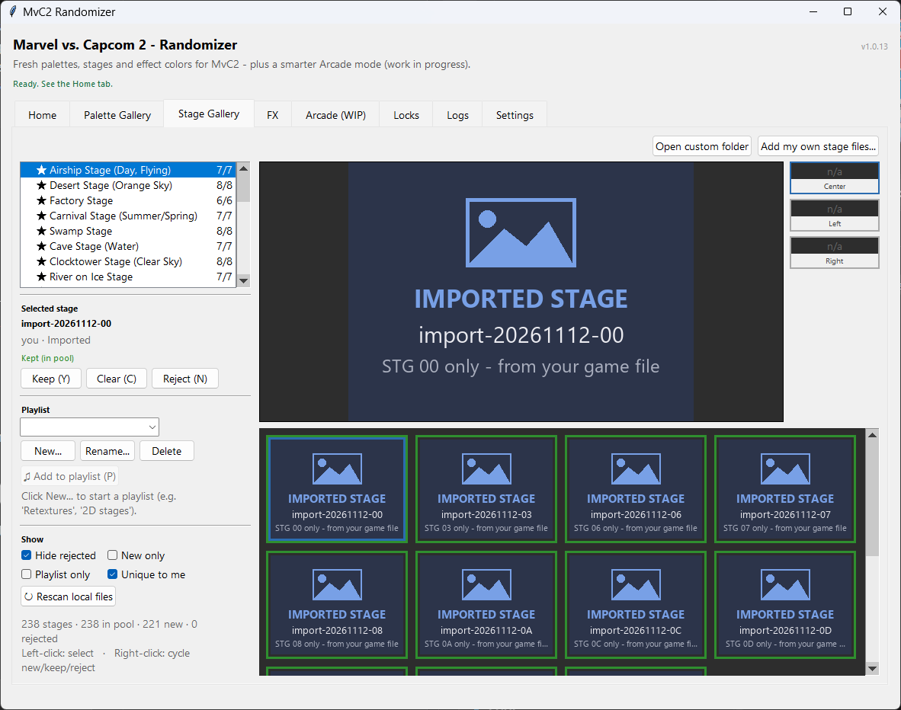

**Unique to me** (in both galleries) shows only what's yours and not in the gallery.

### Adding your own files

- **Palette sheets** go in `custom\skins\<Character>\` (the folders are created for you), or
  use **Add my own palettes...** in the Palette Gallery, which checks each sheet and files it
  under the right character. A sheet must be the gallery format: an indexed PNG with that
  character's exact layout.
- **Stage files** (POL/TEX `.BIN`) go in `custom\stages\`, or use **Add my own stage
  files...** in the Stage Gallery.

## Locks, mixes and sharing

- **Locks** - pin a palette to a character's button, or a stage to a slot, so it never
  changes. On the Locks tab your own stages are marked ★ at the top of each slot's list.
- **Cross-slot stages** (Settings, on by default) - ported and original stages can go in any
  slot they fit, not just Training.
- **Your mix** - pick the six palettes you want for a character (one per button) right in
  the Palette Gallery.
- **Export game file** (Home) - save your finished game file for someone who just wants
  to drop it in, no app needed.
- **Curated mixes** (Settings) - share your keeps, rejects, locks, playlists and FX setup,
  or start from someone else's.

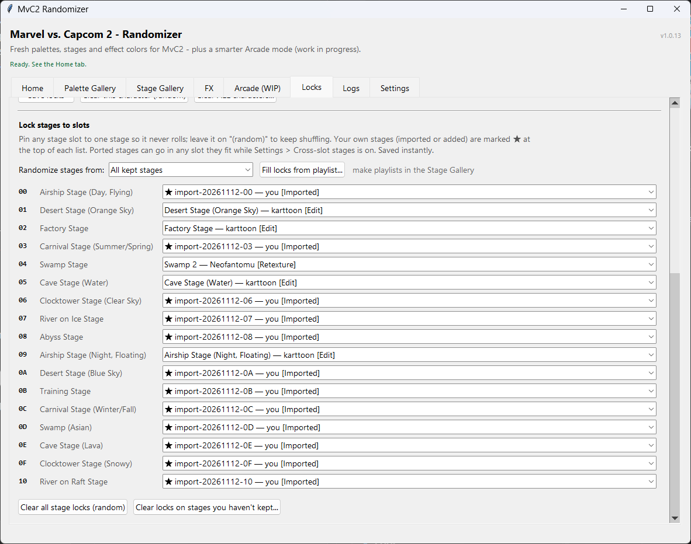

## Something wrong?

**Settings > Save support info** zips your settings and logs (never your game file) to
send with a bug report.

## Credits

Palettes and stages are made by the MvC2 community - see the
[MvC2 Skins Gallery](https://github.com/karttoon/mvc2-skins) for the artists. Palette
data and character offsets come from [PalMod](https://github.com/Preppy/PalMod)'s MvC2
definitions.

## License

MIT
